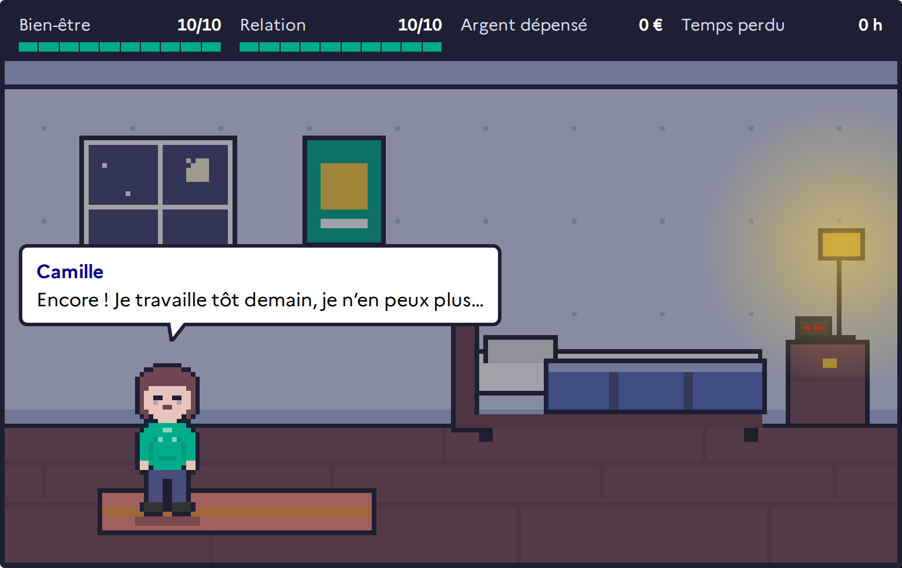

<picture>
  <source media="(prefers-color-scheme: dark)" srcset="https://raw.githubusercontent.com/H0ozsed/H0ozsed/output/terminal-dark.svg">
  
</picture>

I'm Ethaniel, a third-year student at [Epitech](https://www.epitech.eu/) in La Réunion (class of 2029),
specialising in cybersecurity and full-stack development. I like web apps that hold up when
someone tries to break them: input validation, safe outbound requests, secrets that survive a
key rotation. **I'm looking for an internship.**
<!-- TODO: add start date, length and location, e.g. "I'm looking for a 4 to 6 month internship from January 2027, remote or on-site." -->

### What I've built

<table>
  <tr>
    <td width="300" valign="top">
      
    </td>
    <td valign="top">
      <b><a href="https://github.com/H0ozsed/Plugin-Django-widget">django-widget-hub</a></b> · <a href="https://pypi.org/project/django-widget-hub/">PyPI</a> 
      A Django package for declaring dashboard widgets once in Python. It grew out of an Epitech
      project where the hand-written SSRF check had a DNS rebinding gap and the token key broke on
      every <code>SECRET_KEY</code> rotation. The package fixes both with <code>safe_fetch()</code>
      and an encrypted credential store. 
      Python · Django · django-ninja · DRF · CI on GitHub Actions
    </td>
  </tr>
  <tr>
    <td width="300" valign="top">
      
    </td>
    <td valign="top">
      <b><a href="https://github.com/H0ozsed/hackaton-justice">Hackaton Justice</a></b> 
      A web app built by five of us in an October 2026 hackathon. It steers people in an everyday
      dispute (a noisy neighbour, a kept deposit) towards conciliation instead of court. I wrote
      the pixel-art role-play engine where you rehearse the conversation, plus shared UI and tooling. 
      Next.js · TypeScript · Tailwind · Prisma · Vitest · Playwright + axe-core
    </td>
  </tr>
</table>

Most of my school work, including C projects like Corewar and Wolf3D, is in private Epitech
repositories. I'm happy to walk through it in an interview.
<!-- TODO: confirm you are fine naming Corewar and Wolf3D here. -->
<!-- TODO: add security work you can show publicly: CTFs (platform + rank or handle), Root-Me / TryHackMe / HackTheBox profile, write-ups. -->

### Tools I use

<picture>
  <source media="(prefers-color-scheme: dark)" srcset="https://skillicons.dev/icons?i=c,python,ts,django,nextjs,react,tailwind,postgres,prisma,docker,linux,githubactions&theme=dark&perline=12">
  
</picture>

Testing: pytest, Vitest, Playwright. Linting: Ruff, ESLint.
<!-- TODO: remove anything you would not want to be asked about in an interview. -->

### Activity

<picture>
  <source media="(prefers-color-scheme: dark)" srcset="https://raw.githubusercontent.com/H0ozsed/H0ozsed/output/snake-dark.svg">
  
</picture>

The card and the snake are rebuilt every morning by a GitHub Action. They count private contributions, which is where most Epitech work lives.

### Contact

[Email](mailto:momodugta@gmail.com) · [Portfolio](https://h0ozsed.github.io/)
<!-- TODO: add " · [LinkedIn](https://www.linkedin.com/in/your-handle)" to the line above, and confirm this is the email you want recruiters to use. -->
