  

Étudiant en première année à **Epitech** (PGE, promo 2029), à La Réunion. J’aime comprendre
comment les choses marchent **de bas en haut** : la mémoire et les pointeurs en C, puis des
applications web complètes en TypeScript.

- 🎓 Projets Epitech en **C** : algorithmique, graphisme, systèmes
- 🌐 Applications web en **TypeScript / Next.js**, scripts et outils en **Python**
- 🤝 Travail en équipe : issues, pull requests, revue de code, tests automatisés

---

### 🚀 Mes projets

Cliquez sur une image pour l’agrandir, sur le titre pour voir le projet.

<!--
  Pour ajouter un projet : copiez un bloc <td>…</td> ci-dessous, mettez sa capture dans
  assets/ (format paysage, environ 1200 × 750) et changez le titre, les liens et le texte.
  Deux cartes par ligne : au-delà de deux, ouvrez une nouvelle ligne <tr>…</tr>.
-->
<table>
  <tr>
    <td width="50%" valign="top">
      
      <h3><a href="https://github.com/H0ozsed/hackaton-justice">⚖️ Hackaton Justice</a></h3>
      
Régler un litige du quotidien <b>sans passer par le juge</b> : la bonne solution amiable, expliquée simplement, et un jeu de rôle en pixel art pour s’entraîner.

      
<b>Mon rôle :</b> moteur du jeu de rôle, composants accessibles, tests automatisés.

      Hackathon · équipe de 5 · octobre 2026 <code>Next.js</code> <code>TypeScript</code> <code>Tailwind</code> <code>Playwright</code>
    </td>
    <!--
    <td width="50%" valign="top">
      
      <h3><a href="https://github.com/H0ozsed/projet-2">🔧 Projet 2</a></h3>
      
Ce que fait le projet, en une phrase.

      
<b>Mon rôle :</b> ce que vous y avez fait.

      Contexte · date <code>Techno</code> <code>Techno</code>
    </td>
    -->
  </tr>
  <!--
  <tr>
    <td width="50%" valign="top">… projet 3 …</td>
    <td width="50%" valign="top">… projet 4 …</td>
  </tr>
  -->
</table>

---

### 📈 Mon activité

<picture>
  <source media="(prefers-color-scheme: dark)" srcset="https://raw.githubusercontent.com/H0ozsed/H0ozsed/output/stats-dark.svg">
  
</picture>

<picture>
  <source media="(prefers-color-scheme: dark)" srcset="https://raw.githubusercontent.com/H0ozsed/H0ozsed/output/snake-dark.svg">
  
</picture>

Mis à jour chaque jour par une GitHub Action ; inclut mes contributions sur des dépôts privés (projets Epitech).

---

### 🛠️ Ce que j’utilise

  

